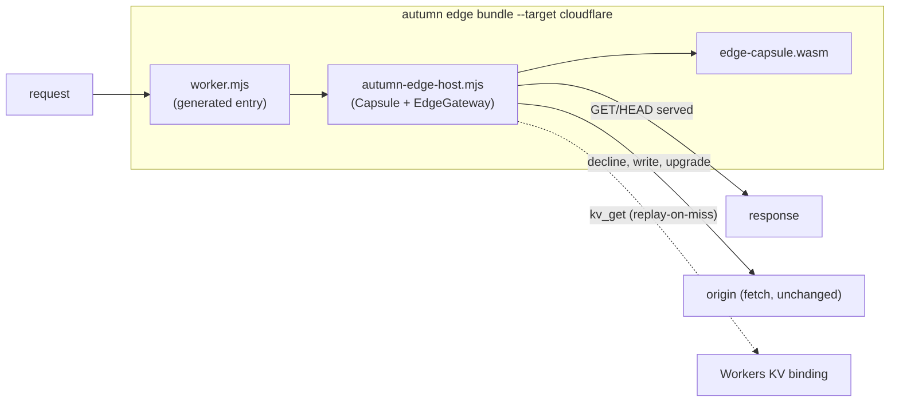

# ADR 0024: Autumn Ships a Web-Standard JavaScript Edge Host

- Status: Accepted
- Date: 2026-10-22
- Deciders: Autumn maintainers
- Tags: edge, wasm, wasi, cloudflare, deployment, conformance
- Amends: [ADR-0011](0011-edge-capsule-read-lane.md) (Alternative 6, "Ship a
  CDN shim in-tree")

## Context

ADR-0011 shipped the edge capsule as "an artifact plus a documented protocol"
and rejected an in-tree CDN shim: a vendor binding would couple Autumn's
release cadence to a CDN SDK, and would need maintaining per vendor. Its
2026-10-05 amendment added one runnable target, `autumn edge serve`, which is a
server you run near your users. It is not a CDN.

The first production edge app, `deadswitch-watchdog` (a status page served
from a Cloudflare Worker), shows the cost of that. To deploy one `#[edge]`
route it had to hand-write:

1. **A WASI preview-1 shim and the wire protocol** (`worker/host.js`, about
   200 lines), restating `autumn-edge/src/host.rs` from the guide.
2. **A KV workaround.** Workers KV is asynchronous and a WASI call is not, so
   the Worker read the one key it knew about before running the capsule and
   answered `kv_get` from that snapshot. A second key, or a renamed one,
   silently becomes a miss.
3. **Fallthrough handling.** The Worker answered every decline with a 503
   instead of forwarding it, because forwarding (hop-by-hop headers,
   `x-forwarded-*`, no redirect following) was more to write.
4. **A deploy script** against the Cloudflare API.

The shim had also drifted from the reference host in ways nothing could
detect. It seeded `random_get` from `crypto.getRandomValues`, so a capsule was
no longer deterministic. It did not strip an inbound
`x-autumn-edge-fallthrough`. It skipped the gateway's response checks:
`set-cookie`, hop-by-hop headers, the status range, `content-length`. Every one
of these is a guarantee ADR-0011 makes, and a hand-written shim loses it
without a test failing.

The premise of Alternative 6 does not hold for this shim, though. The watchdog
host imports **no vendor SDK**. It uses `WebAssembly`, `TextEncoder`, `atob`,
`fetch`, `Request` and `Response`. These are the WinterTC Minimum Common API,
which Cloudflare Workers, Deno, Bun, Vercel and Netlify edge functions, and
Node 18+ all implement. The part that is vendor-specific is only the entry
point (`export default { fetch(request, env) }`) and the config file
(`wrangler.toml`). Neither has an SDK cadence to couple to.

## Decision

Autumn ships a **web-standard JavaScript edge host** in `autumn-edge`, and a
CLI command that bundles it with a capsule for a platform.

1. **`autumn-edge/js/autumn-edge-host.mjs`.** One ES module with no
   dependencies. It has two layers:
   - `Capsule` is `autumn_edge::host` in JavaScript. It has the same WASI
     surface (the same 15 imports, the same errno for each refusal), the same
     NDJSON dialogue, the same output budgets, a fixed clock and the same
     fixed-seed SplitMix64 entropy. A capsule that runs under one host runs
     under the other.
   - `EdgeGateway` is `autumn_edge::gateway` plus the edge node's forwarding
     rules, over the Fetch API. GET/HEAD go to the capsule. The capsule's
     answer gets the gateway's checks. Every decline, write and upgrade goes
     to the origin unchanged: no redirects followed, hop-by-hop headers
     stripped, and the gateway is the first proxy for `x-forwarded-*`. It
     also probes the origin's static security headers once, as
     `autumn edge serve` does.

   The Rust crate exposes the source as `autumn_edge::js::HOST`, so the CLI
   embeds the exact file the tests ran.

2. **Async KV by replay-on-miss.** `Capsule.run` answers `kv_get` from a
   per-request snapshot. On a key the snapshot does not have, it unwinds the
   instance, awaits the read, and runs the request again from the start. This
   is sound because the host makes the capsule deterministic: the clock is
   fixed, the entropy is fixed, and the only input is the request frame. A
   request that reads N distinct keys costs at most N + 1 instantiations, and
   past 32 keys it falls through. A KV source is a function, a `Map`, or a
   Workers KV binding (`get(key, "arrayBuffer")`). A failed read is a miss,
   as `EdgeKv` requires.

3. **`autumn edge bundle --target cloudflare`** writes `edge/cloudflare/`:
   - the capsule, the host and a generated `worker.mjs`, rewritten on every
     bundle (and listed in a generated `.gitignore`);
   - a `wrangler.toml`, written once and then kept, so a KV namespace id or a
     route the author adds survives.

   Before it writes anything, it refuses a capsule that imports something the
   host does not provide, and names the import. `wrangler deploy` deploys the
   bundle. Autumn calls no Cloudflare API.

4. **The JS host is held to the reference host by tests**, not by review:
   - `autumn-edge/tests/js_host.rs` runs hand-written WAT guests through both
     hosts. It covers each errno, entropy, malformed frames, stderr capture,
     denied imports, the memory budget and replay. It also runs the JS
     gateway's own `node --test` suite.
   - Tier J of the edge-greeting conformance suite runs the real capsule over
     the corpus and the 10,000 generated requests. It requires the same
     outcome from both hosts, on the synchronous path and on the replay path.
   - The edge-conformance CI job runs the generated bundle in **workerd**
     (`wrangler dev`), Cloudflare's open-source runtime. It runs against the
     real origin binary with a seeded KV namespace.
   - Unit tests in `autumn_edge::js` read the JS constants (sensitive headers,
     hop-by-hop headers, budgets, the import list) back out of the source and
     compare them with the Rust ones.

## Design Details

- **Why not mirror the gateway in `worker.mjs`?** The generated entry is ten
  lines that pass `env` bindings to `createEdgeGateway`. All behaviour lives
  in the host module, which is the tested file. An app that has its own
  Worker, such as the watchdog with its cron trigger and webhook routes,
  imports `createEdgeGateway` and passes a **function** origin, so its own
  routes are the fallthrough target.
- **What the Fetch API cannot express.** The JS host differs from the Rust
  gateway in three places, and the guide documents each:
  - A JavaScript engine cannot meter instructions. The platform's CPU limit
    bounds a runaway capsule instead of a fuel budget.
  - Memory past the 256 MiB budget is refused after instantiation, not on
    each `memory.grow`.
  - `Headers` joins a repeated request header into one comma-separated value
    before the capsule sees it. A header value that is not ASCII is sent to
    the origin only, because `Headers` cannot show whether its bytes were
    UTF-8.
- **Identity.** An `identity` resolver returns verified `{ user_id, roles }`
  claims, which cross the wire as `EdgeIdentity` does. A resolver that throws
  sends the request to the origin, as the guide requires for identity
  infrastructure errors.

## Consequences

### Positive

- Deploying an edge app to Cloudflare is `autumn build`,
  `autumn edge bundle --origin …`, `wrangler deploy`. The author writes no
  JavaScript.
- Every guarantee ADR-0011 makes (determinism, credential stripping, the
  response checks, transparent fallthrough) now holds on a real CDN, and CI
  proves it in the CDN's own runtime.
- The same host module runs on Deno, Bun, Vercel and Netlify edge functions
  and Node. A second `--target` is an entry template and a config file, not a
  second host.
- `autumn-edge` gets a second, independent host implementation, which makes
  the wire protocol's specification executable from two sides.

### Negative

- **A second language in the edge lane.** The JS host must change when the
  wire protocol changes. Mitigation: Tier J and the WAT parity suite fail
  on any divergence, and the constant-drift tests fail on a list change.
- **Node in CI.** The `test` and `edge-conformance` jobs install Node 22, and
  the edge-conformance job downloads `wrangler` (pinned) to run workerd.
- **Replay costs instantiations.** A request that reads many keys pays one
  instantiation per key. `preload` removes that cost for keys known ahead.

## Alternatives Considered

### 1. Keep shipping no host (ADR-0011 as written)

Rejected. The watchdog is the evidence: the shim gets written anyway, outside
the conformance suite, and drifts in exactly the ways the suite exists to
catch.

### 2. A vendor binding (`workers-rs`, a Lambda runtime crate)

Rejected for the reasons ADR-0011 gives, which still hold. It would couple
Autumn's releases to the vendor's SDK, and it would mean one binding per
vendor. The web-standard host needs neither.

### 3. JavaScript Promise Integration (JSPI) for async KV

Deferred. `WebAssembly.Suspending` would let a `kv_get` await without a
replay. It is not available on every target runtime yet. Replay works
everywhere today, and the protocol does not change when JSPI replaces it.

### 4. A `wasi:http` component

Still the long-term target named in ADR-0011. The CDN runtimes this ADR
targets do not run Preview 2 components.

## Non-Goals

- Deploying. `wrangler deploy` (or the platform's own CLI) deploys. Autumn
  holds no CDN credentials.
- Populating the edge KV. The origin publishes; distribution is the
  platform's job (ADR-0011).
- Bundle targets beyond Cloudflare in this change. The host runs on the
  others today; their entry templates are follow-on work.

## Follow-On Work

- `--target deno` and `--target vercel` entry templates.
- Swap replay for JSPI where the runtime supports it, behind the same API.
- A Workers-side counter per fallthrough reason (ADR-0011's observability
  follow-on), through `onLane`.
