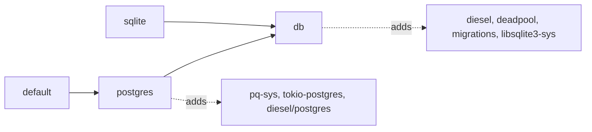

# ADR 0025: A `postgres` Feature Holds the Postgres Client

- Status: Accepted
- Date: 2026-10-25
- Deciders: Autumn maintainers
- Tags: features, sqlite, postgres, build

## Context

`db` enabled `pq-sys`, `pq-src`, `tokio-postgres`, `tokio-postgres-rustls`,
`webpki-roots` and diesel's Postgres backend. `sqlite` enables `db`. The
workspace `diesel` and `diesel-async` entries also enabled `postgres`. Thus
every build of `autumn-web` had the Postgres client. This included
`--no-default-features --features sqlite` (issue #2605). The SQLite guide
promises a zero-ops tier. The client added build time, a second C library and
audit surface.

`autumn/src` has about 1,080 `feature = "db"` gates. About 115 sites in code
that a SQLite build compiles name a Postgres crate.

## Options

1. **`db` is the shared layer. A new `postgres` feature adds the client.**
   `default` enables `postgres`. Gate the Postgres sites on `postgres`.
2. **`db` keeps the client. A new `db-core` is the shared layer.** Rename the
   1,080 gates to `db-core`.
3. **A `build.rs` cfg alias.** The same rename, and it is harder to read.
4. **A separate Postgres crate.** A large API break.
5. **Docs only.** Remove the promise.

Options 2 and 3 do not solve the main problem. A feature that only adds `db`
(`seed`, `repl`) must still pick a backend when it is enabled alone. They also
touch every open PR that edits a gated line.

## Decision

Option 1.

- `db` has no Postgres crate. `postgres = ["db", <Postgres crates>]`.
- `default` and `managed-pg` enable `postgres`.
- The workspace `diesel` and `diesel-async` entries do not enable `postgres`.
- Code that names a Postgres crate is gated on `postgres`, not on
  `not(sqlite)`. A default build that also enables `sqlite` keeps this code.
- `db` with no backend stops at one `compile_error!`.
- Code that both backends call stays on `db`. Where a Postgres-only path can
  still be reached on a build without `postgres` (startup migrations, replica
  checks), a fallback refuses with a clear message.

## Consequences

- A SQLite app with default features off compiles no Postgres client. CI
  checks this with clippy and `cargo tree`.
- Breaking: a build with default features off that enables `db` without
  `sqlite` must add `postgres`. See `docs/migrations/0.9.0.md`.
- `cargo hack --each-feature` skips `db`, `seed`, `repl`, `offline-sync` and
  `ledger-profile`. Curated combinations build them with each backend.
- The semver gate names `postgres` for the current build only, until a
  published baseline has it.
- A new `cfg(feature = "db")` item that names a Postgres crate fails the
  SQLite-only CI step. Gate it on `postgres`.
- Generated code that names a Postgres type sits in
  `::autumn_web::__if_postgres!`. Without `postgres`, the macro drops it.
- `autumn-cli` still enables `postgres` on its SQLite build. Its own code uses
  Postgres directly. That is a separate change.
