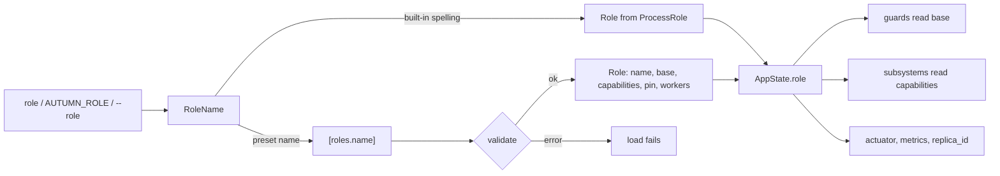

# ADR 0035: Named Roles

- Status: Accepted
- Date: 2026-11-03
- Deciders: Autumn maintainers
- Tags: config, roles, jobs, deployment

## Context

Issue [#3543](https://github.com/autumn-foundation/autumn/issues/3543), part
of epic [#3540](https://github.com/autumn-foundation/autumn/issues/3540).
It builds on [ADR 0033](0033-role-capabilities.md).

An operator who runs a `critical` worker tier and a `bulk` worker tier sets
`AUTUMN_ROLE=worker` and `AUTUMN_JOBS__PIN` on each Deployment. The operator
declares the same tiers again in `[jobs.fleet] tiers` for `autumn doctor`.
The process cannot tell which tier it is.

## Options

1. **Presets over a built-in base.** `[roles.<name>]` sets `base` plus
   role-shaped keys. The built-in roles stay the safety contract.
2. **Free roles.** A role sets every capability, with no base.
3. **Role profiles.** A role can set any config key, as a profile does.

## Decision

Option 1.

- `AutumnConfig.role` is a `RoleName`: a built-in role or a preset name.
  `AutumnConfig.roles` holds the presets.
- A preset sets `base`, `pin`, `workers` and the capability overrides
  `job_workers`, `scheduler`, `outbox_relay`, `commit_hooks`, `fleet_relay`,
  `restore_check` and `retention`. Unknown keys fail the load.
- **Invariant:** the capabilities of a preset are a subset of the
  capabilities of its base. An override can only turn a capability off.
  `serves_http` always equals the base. `verification/role_presets.rs`
  proves it.
- `pin = []` means no job workers. Omitted `pin` means `jobs.pin`.
- A preset `pin` and `workers` replace `jobs.pin` and `jobs.workers` at the
  job runtime call site, not in the loader. A custom config loader gets the
  same result.
- The guards (durable backend, file-backed SQLite) read the base. A
  `combined` preset with no job workers counts as `web`, because it enqueues
  and does not drain.
- `state.role()` returns `&Role`. A built-in role holds no preset data, so a
  clone of `AppState` costs no extra reference count.
- A preset adds a `role` metric label and a `replica_id` prefix. A built-in
  role does not, so its metric series and replica id do not change.
  `/actuator/info` and `/actuator/jobs` add a `role` object for every role.
- `autumn doctor` derives `[jobs.fleet] tiers` from the presets when `tiers`
  is not set. It uses the same `autumn_web::config` functions as the boot. A
  gap in derived tiers is a warning, because a built-in tier is not in the
  list. `--strict` fails on it.
- `[roles]` becomes a framework-owned top-level key.
- Open question answers: a preset can set `workers`. A preset cannot set
  other config.

## Consequences

- `state.role()` and `config.role` change type. This is a breaking change
  with a migration guide entry.
- A new capability needs a new override key in `RolePreset`.
- Option 2 can enable a capability that its base cannot run safely.
  Option 3 makes a second profile system.
