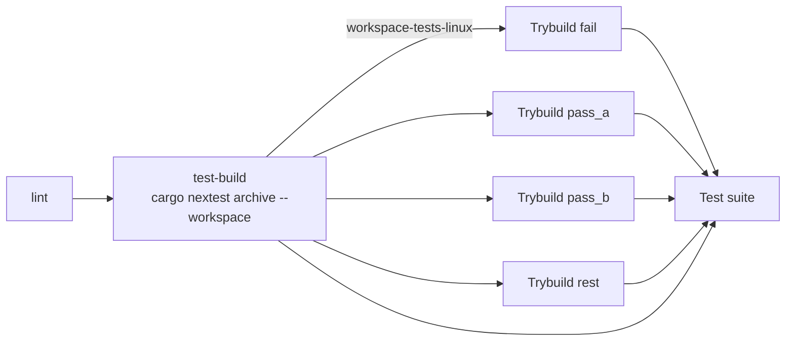

# ADR 0035: Build the Trybuild Shards' Tests Once With a Nextest Archive

- Status: Accepted
- Date: 2026-11-03
- Deciders: Autumn maintainers
- Tags: ci, build-time, testing

## Context

CI runs `compile_fail::` (trybuild) in four Linux shards (#2519). Each shard
ran `cargo test --workspace --test integration_tests` and so compiled the
whole workspace test build before it ran its slice. On the cold-cache trunk
run 14053 that compile was 20m35s of the 35-minute `Trybuild pass_a` job.
All four shards paid it, so about 80 runner-minutes went to the same build.
#2519 named the fix as a follow-up: build once, run many, with
`cargo nextest archive`.

The shards have to build with `--workspace`. The workspace's unified feature
set decides which `#[cfg(feature = ...)]`-gated fixtures exist. Narrowing the
package selection drops fixtures, and the shard still reports green.

## Decision

- A new Linux job, `test-build`, runs `cargo nextest archive --workspace` and
  uploads the archive as the `workspace-tests-linux` artifact.
- Each `trybuild` shard needs `test-build`, downloads the archive and runs
  `cargo nextest run --archive-file … --workspace-remap . --extract-to .`
  with a filterset over `binary_id(autumn-web::integration_tests)`.
  `--no-tests=fail` replaces the old `test result: ok. N passed` grep.
- `.config/nextest.toml` adds `target/debug/.fingerprint` to every archive and
  fails the archive when it is missing.
- `test-build` publishes its checkout path as a job output. A shard checked
  out at another path builds locally, as before.
- The `test` job is unchanged. It still runs `cargo test --workspace` on all
  three OSes, doctests included.

### Why the archive goes into the checkout

Tests use `env!("CARGO_MANIFEST_DIR")` and `env!("CARGO_BIN_EXE_*")`. These
are absolute paths, fixed when the binary is compiled. `compile_fail.rs` uses
them too. `--workspace-remap` fixes only the runtime environment, so a
consumer has to run at the builder's checkout path. Extracting with
`--extract-to .` puts `target/` back where cargo built it. GitHub-hosted
runners always check out at the same path. The self-hosted pool gives each
runner slot its own work directory, so a shard there may not match. It then
builds locally instead of failing.

### Why the fingerprint directory

trybuild builds its fixture project with the features of the test binary that
runs it. It finds them in `target/debug/.fingerprint/<unit>/*.json`, next to
`target/debug/deps/<binary>`. A plain archive does not include that directory.
trybuild then passes no features, so each gated fixture builds against default
features. A throwaway crate with one gated fixture showed both cases on Rust
1.97 and 1.99: `cannot find function` without the include, a pass with it.

## Consequences

- The Linux workspace test build compiles twice per run (`test` and
  `test-build`) instead of five times. Both share the `workspace-test` cache
  key. `test` is still its only writer.
- A trybuild shard starts after `test-build`. Wall-clock for a shard stays
  about the same: about 21 minutes of archive build, then the fixtures. The
  shards no longer restore the multi-GB cache, and they no longer compile.
- The archive is uploaded for one day and is read only by this run.
- Moving `test`'s own lanes onto the archive, or splitting them with
  `--partition`, is not part of this change. Doctests do not run under
  nextest. The macOS and Windows legs would also need their own archive.
