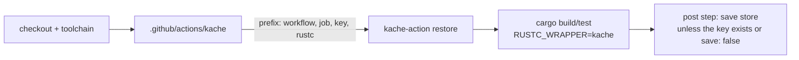

# ADR 0036: Cache CI Builds per Compile With kache

- Status: Accepted
- Date: 2026-11-04
- Deciders: Autumn maintainers
- Tags: ci, build-time

## Context

Every Rust job in `.github/workflows/` restored and saved its `target/`
directory with `Swatinem/rust-cache`. That cache has two blind spots for this
workspace:

- It removes the workspace crates' artifacts before saving. Every job
  therefore recompiled autumn-web, the macro crates and every other workspace
  member, even on a run where none of them changed.
- It keys one whole target directory. A job that builds a different feature
  set restores only what that set has in common with the saved directory.

[kache](https://github.com/kunobi-ninja/kache) is a `RUSTC_WRAPPER` that
caches each compile by the hash of its inputs (sources, flags, rustc). A crate
whose inputs did not change is restored, workspace crate or not.

The trial ran in #3612 (run 41853082676). It timed `cargo test -p autumn-web
--lib --no-run` on `ubuntu-latest`, with a cold seed job per cache followed by
fresh runners restoring it. Each figure is the cache-action step plus the
build step.

| Case | rust-cache | kache |
| --- | --- | --- |
| Cold build, then save | 272 s | 288 s |
| Nothing changed | 162 s | 59 s |
| `autumn/src/lib.rs` edited | 156 s | 127 s |
| `markdown` feature set on the same cache | 149 s | 146 s |

Restoring the 1.9 GiB store took 9–13 s, close to rust-cache's 8–11 s. In the
"nothing changed" case, the remaining kache misses were build-script runs,
mostly aws-lc's C build, which the action only caches with `cache-c-cpp`. In
the trunk history at the time, about a quarter of commits changed no Rust or
Cargo file, and about half changed autumn-web or autumn-macros source.

## Decision

- Every workflow job that used `Swatinem/rust-cache` uses the local composite
  action `.github/actions/kache` instead. It is the one place the repo
  configures `kunobi-ninja/kache-action`: the pinned action commit, kache
  v2.0.0, `cache-c-cpp` (except on Windows), the Windows cache directory, and
  no PR comments.
- The GitHub cache key is `<prefix>-<kache version>-<os>-<arch>-<Cargo.lock
  hash>`, and the action never re-saves a key that exists. The composite
  builds the prefix from the workflow, the job id, an optional `key`, and the
  exact rustc (release and commit). Jobs that run the identical build share an
  entry with `shared-key`; restore-only jobs pass `save: false`.
- Jobs that time compiles (the dev-loop, dev-loop scaling and cold-start
  measurements) blank `RUSTC_WRAPPER` and unset the CMake launchers in the
  timed step, so they time the plain toolchain.
- Dependabot's GitHub Actions updates also scan `.github/actions/*`, so the
  pinned action commit inside the composite is updated with the rest.

## Consequences

- A run that leaves a crate's inputs unchanged restores that crate, workspace
  crates included. The generated-app builds in `generator-conformance.yml`
  also go through kache, which rust-cache never covered.
- The cargo registry and `$CARGO_HOME/bin` are no longer cached. Crate
  downloads add a few seconds per job. Tools come from their pinned installs,
  which the cargo-deny gates already required.
- A different feature set still recompiles autumn-web, whose key includes its
  features. Per-lane keys stay.
- The first job to save a key fixes its contents until `Cargo.lock`, rustc or
  kache changes. Entries go stale as workspace code moves on, as rust-cache
  entries did.
- C/C++ objects are cached on Linux and macOS only. On Windows,
  `cache-c-cpp` would replace MSVC `cl.exe` with `clang-cl`, which changes the
  C toolchain the build uses.
- The store counts against the repository's 10 GB Actions cache in place of
  the target directories. If entries start evicting each other, the next step
  is a remote store (S3 or R2) through the action's `s3-*` inputs, or
  `node-cache` on the self-hosted runners.
- Scaffolded apps (`autumn-cli/src/templates/.github/workflows/*.tmpl`) still
  use rust-cache. What a generated app's CI uses is a separate decision for
  its users.

## Alternatives

- **Keep rust-cache.** It is simpler, but it rebuilds every workspace crate on
  every run.
- **sccache.** Also a per-compile `RUSTC_WRAPPER` cache. kache's GitHub action
  stores into the Actions cache with no external service, and its restores
  hardlink into `target/` instead of copying.
