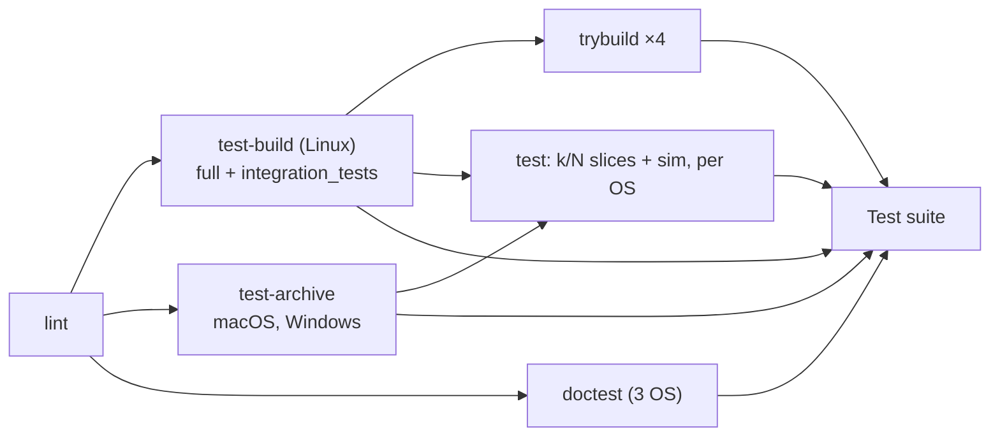

# ADR 0036: Run the Test Job as Partitions of a Nextest Archive

- Status: Accepted
- Date: 2026-11-04
- Deciders: Autumn maintainers
- Tags: ci, build-time, testing

## Context

ADR 0035 moved the `trybuild` shards onto a `cargo nextest archive` build.
The `test` job still ran one job per OS. Each job compiled the workspace, ran
`cargo test --workspace -- --skip compile_fail:: --skip sim_`, then ran the
`sim_` lane single-threaded. On run 14466 those two steps took:

| OS | `Run tests` (compile, tests, doctests) | `sim_` lane |
|---|---|---|
| ubuntu | 31m52s | 7m41s |
| windows | 48m18s | 15m03s |
| macOS | 1h58m38s | 10m57s |

`Test (macos-latest)` was the critical path of the workflow. Its tests could
not use more than one runner.

## Decision

- **One build per OS.**
  - `test-build` (Linux) runs `cargo nextest archive --workspace` and uploads
    `workspace-tests-Linux`. From the same compile it also packs the
    `--test integration_tests` archive that the `trybuild` shards read
    (`trybuild-tests-linux`).
  - `test-archive` does the full archive for macOS and Windows.
- **`test` is a matrix of `{os, shard}`.**
  - A `k/N` shard runs
    `-E 'not (test(compile_fail::) | test(sim_))' --partition count:k/N`.
  - A `sim` shard runs `-E 'test(sim_)' --test-threads 1` with the liveness
    watchdog armed.
  - Slices: ubuntu 2, Windows 3, macOS 4. Each OS has one `sim` shard.
  - nextest partitions after filtering, so the slices of one OS cover the
    default lane exactly. Checked on a real archive: three slices of a
    filtered set held 18 + 18 + 18 tests, the same set and no duplicates.
- **`doctest` runs `cargo test --workspace --doc` per OS.** nextest does not
  run doctests. Every doctest that matches `sim_` is `ignore`, so nothing
  loses its single-threaded run.
- **Every shard runs `cargo fetch --locked`.** Tests that run `cargo`
  themselves need the registry, and the archive brings none.
- **`test-gate` needs every new job.**
- **`repo_hygiene` checks the shards.** Each OS's slices must be exactly
  `1/N..N/N`, and each OS must have one `sim` shard.

### Why `test` needs both archive jobs

`needs` applies to the whole job, not to one matrix entry. So the Linux
shards also wait for the macOS and Windows builds. Linux is not the critical
path, so this costs no wall-clock time. `trybuild` needs only `test-build`.

### Why doctests are a job of their own

As a step of an archive job, they would hold back every shard, because a
shard waits for the whole job. As their own job they run beside the builds.
The cost is a second compile of the library crates per OS. On a warm cache
that compile is small.

### Paths

ADR 0035 explains why a consumer must extract the archive into a checkout at
the builder's path. macOS and Windows always run on GitHub-hosted runners,
which use a fixed path per OS. A Linux shard compares its path with
`test-build`'s output. On a mismatch (a self-hosted runner slot), it builds
locally with the same filter and partition.

## Consequences

- Each test runs in its own process. A test can no longer pass or fail
  because of process-wide state left by another test in the same binary.
  `cargo test` still runs tests side by side, locally and in the feature and
  Docker lanes, so the rule in `CLAUDE.md` about process-global state still
  holds.
- Every `sim_` test pays the app warm-up in its own process. The rule to start
  a wall-clock budget after `sim.build` matters more now.
- The full Linux archive is about 6.9 GB. Each `test` shard downloads and
  extracts it, about 6 minutes on Linux. That is the price of not compiling.
- Change a slice count for all slices of that OS at once. `repo_hygiene`
  fails on a gap.
