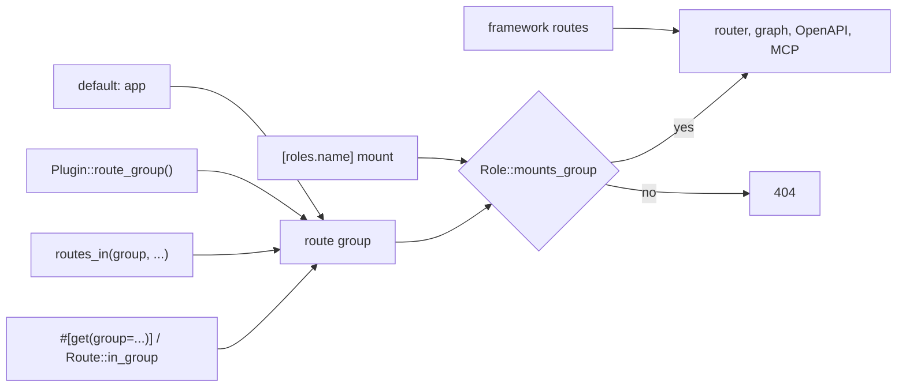

# ADR 0036: Route Groups and Per-Role Mounting

- Status: Accepted
- Date: 2026-11-04
- Deciders: Autumn maintainers
- Tags: routing, roles, deployment

## Context

Issue [#3544](https://github.com/autumn-foundation/autumn/issues/3544), part
of epic [#3540](https://github.com/autumn-foundation/autumn/issues/3540).
It builds on [ADR 0035](0035-named-roles.md).

A role serves every user route (`combined`, `web`) or none (`worker`). An app
cannot run its marketing pages on one set of pods and its service desk on
another from one image.

## Options

1. **Groups on routes, `mount` on presets.** A route has a group. A
   `[roles.<name>]` preset lists the groups it serves.
2. **Path prefixes on presets.** A preset lists URL prefixes.
3. **One binary for each service.** Separate crates and builds.

## Decision

Option 1.

- A route group comes from, in order: the route attribute or
  `Route::in_group`, `AppBuilder::routes_in`, `Plugin::route_group` (default
  `Plugin::name`), then `app`.
- `merge` and `nest` routers get the group of the code that adds them.
  `plugin_assets` routers are shared.
- `RolePreset.mount` is the list of groups. Unset means every group. `mount`
  needs an HTTP base. `mount = []` and a blank name fail the load.
- One filter (`MountTargets::retain`) runs before the graph census, the
  router build, the `OpenAPI` export and MCP. They cannot disagree.
- A `mount` entry that names no group fails the boot.
- Framework routes are built from config, not from the filtered lists. Every
  HTTP role serves them. A test checks this.
- The no-routes check runs on every route, before the filter.
- A route in an unmounted group gets 404, not 421. A 421 tells a browser to
  retry on a new connection. Behind one ingress that retry goes to the same
  pods. A 404 also does not show that the route exists.
- Auth callbacks are app routes, not framework routes. The app puts each
  callback in a group that each role which starts a login mounts.
- Pre-rendered pages follow the group of their route. A role drops the
  `dist/` pages and sitemap entries of its unmounted static routes.
- Path helpers are compile-time functions. A link to a route in another group
  still builds.
- The graph adds `completeness.mounted_elsewhere`: routes that this role does
  not mount and another declared preset does. They are not drift.
- `autumn doctor` reads the groups from `[route_groups]` (`manifest`, the
  `autumn routes --format json` output, or `declared`). A group that no preset
  mounts is a warning. `--strict` fails on it. The runtime does not read
  `[route_groups]`.
- `verification/route_groups.rs` models the mount rules.

## Consequences

- `Route` has a new public field `group`. A `Route { .. }` literal needs it.
  The route macros set it.
- `RouteInfo` has a new field `group`. `Completeness` has a new field
  `mounted_elsewhere`.
- `AutumnConfig` has a new field `route_groups`, and `[route_groups]` is a
  framework-owned top-level key.
- Two groups can own the same path. A narrow role boots. A role that mounts
  both groups fails the duplicate-route check, as before.
- Option 2 breaks when a URL moves. Option 3 loses the one-build compiler
  check across services.
