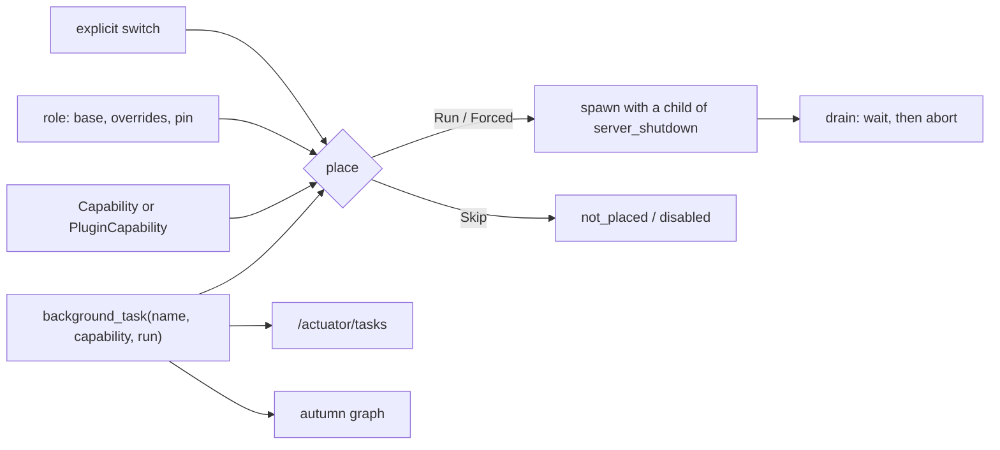

# ADR 0039: Role-Aware Background Tasks

- Status: Accepted
- Date: 2026-11-05
- Deciders: Autumn maintainers
- Tags: plugins, roles, deployment

## Context

Issue [#3545](https://github.com/autumn-foundation/autumn/issues/3545), part
of epic [#3540](https://github.com/autumn-foundation/autumn/issues/3540).
It builds on [ADR 0033](0033-role-capabilities.md) and
[ADR 0035](0035-named-roles.md).

The framework gates its own background work by capability. A plugin starts
its loops with `tokio::spawn` in `on_startup`, and every role runs every
startup hook. So `AUTUMN_ROLE=web` still runs plugin loops. Each plugin adds
its own switch, or none. Nothing can say which process runs what.

## Options

1. **Declared tasks.** A plugin registers a task with a capability. The
   framework places it, stops it and lists it.
2. **Documented self-gating.** Each plugin reads `state.capabilities()` in
   `on_startup`.
3. **A role check in `on_startup`.** Run startup hooks only on some roles.

## Decision

Option 1.

- `AppBuilder::background_task(name, capability, run)` and the full form
  `AppBuilder::background(BackgroundTask)`. `run` gets the state and a child
  of the server shutdown token, and returns `AutumnResult<()>`.
- A new built-in capability, `maintenance`, for housekeeping loops. Its
  defaults are those of the other background capabilities.
- `PluginCapability::new("<plugin>.<name>", parent)`. A role runs it when it
  runs the parent. `[roles.<name>] capabilities = { ... }` sets it. A role
  cannot turn on a plugin capability that its base does not run, as for the
  built-in keys. The `.` keeps a plugin name apart from every built-in name.
- `true` above the base fails the boot, on every declared preset. A key that
  no plugin declares fails the boot of that role. On another preset it is a
  warning, because another binary can link other plugins.
- A task with `queues` runs only where the role runs job workers and its pin
  admits one of the queues. The `autumn jobs manifest` output includes the
  queues, so the doctor coverage check sees them. A pin that names only a
  task queue is not an error on any jobs backend.
- `explicit(Some(true))` starts the task on every role. The boot logs a
  warning on each role that does not place it. This follows "security
  defaults, not security blocks": the plugin config wins.
- The framework starts tasks after the startup hooks, and not in
  `autumn task`. After the request drain, the drain waits for the tasks for
  at most half of the remaining `shutdown_timeout_secs`. Then it aborts the
  tasks that did not stop. The fleet close and the hooks keep the other half.
- The framework does not restart a task that returns or panics.
  `/actuator/tasks` shows `stopped`, `exited`, `failed`, `panicked` or
  `aborted`.
- One function, `roles_running`, gives the roles for `/actuator/tasks` and
  for the graph. They cannot disagree.
- `verification/background_tasks.rs` models placement.

## Consequences

- `NodeKind` has a new variant `BackgroundTask`. An exhaustive `match` on it
  needs a new arm. `GraphNode` has a new field `background`. `Completeness`
  has a new field `background_tasks`.
- `RoleCapabilities`, `Capability` and `RolePreset` are `#[non_exhaustive]`,
  so `maintenance` and `capabilities` break no caller.
- Option 2 is the state before this ADR: plugins did not do it. Option 3
  cannot express a plugin capability, a queue or the graph entry.
- No restart policy. A task that must survive an error loops inside `run`.
- The in-repo plugins move to this API in #3546.
