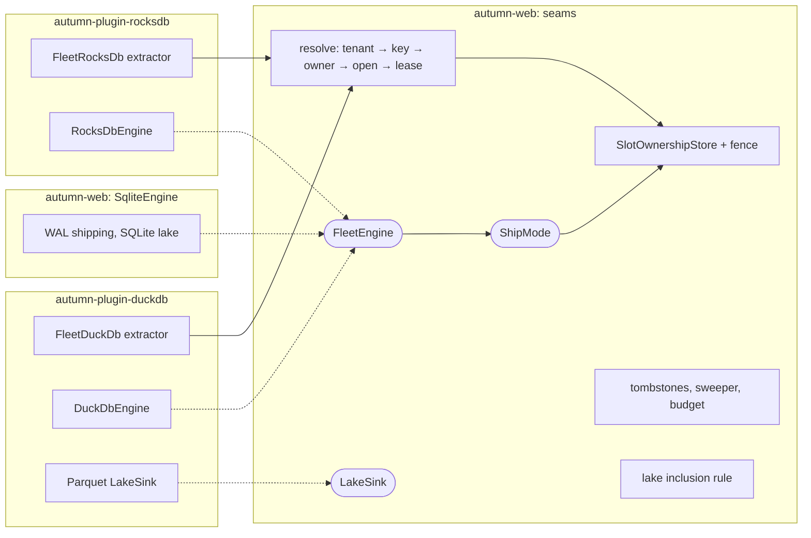

# ADR 0040: Fleet Engine Seams

- Status: Accepted
- Date: 2026-11-05
- Deciders: Autumn maintainers
- Tags: fleet, plugins, sqlite, duckdb, rocksdb

## Context

[ADR 0019](0019-sqlite-database-fleet.md) made the SQLite fleet: one file per
tenant or per slot, opened on demand, owned by one host, and restored from
object storage. [ADR 0032](0032-fleet-lake-query.md) added the lake: a
cross-tenant query over the replicas. It rejected DuckDB as a core
dependency and deferred Parquet.

SQLite, DuckDB and RocksDB are different engines. They have one shape in
common: each is a very good engine for one host and one volume. The fleet is
the part that makes many of them act as one data tier. Most of it does not
depend on SQLite:

| Engine-agnostic today | SQLite-bound today |
|---|---|
| Slot hash and paths (`fleet_layout.rs`) | WAL frame shipping (`replication/engine.rs`) |
| `OwnershipTable`, `SlotOwnershipStore`, fencing epochs | Migrations through diesel `Sqlite` |
| 421 `NotOwner` routing and `CellRouter` | `VACUUM INTO` backups and the delete guard |
| Tombstone rules (`fleet_tombstones.rs`) | Identity and epoch rows inside each file |
| `FleetLifecycle` hooks and `ReplicaDestination` | The lake: `ATTACH` and one SQLite lake file |
| Sweeper scheduling | `Pool<RuntimeConnection>` in `FleetDatabase` |

All of `db/fleet*.rs` compiles only with `sqlite`, and `sqlite` excludes
Postgres. So a Postgres app cannot run any fleet. The DuckDB and RocksDB
plugins each open one database per app. Both list more than one database
as out of scope.

Other teams have hit the limits of single-node engines run per tenant. The
lessons that apply here:

- An engine sized before the query arrives runs out of memory. Many open
  instances on one host multiply that risk.
- A lake catalog kept in a shared SQL database becomes the bottleneck.
- A data engine behind a database wire protocol has a long tail of client
  problems.
- Patches carried in a fork of the engine cost more than they save.

## Options

1. **Core exposes seams. Plugins carry engines.** Core owns ownership,
   fencing, routing, tombstones, scheduling and the lake inclusion rule.
   Each engine, extractor and lake sink lives in its plugin.
2. **Engines in core behind features.** Add `duckdb` and `rocksdb` features
   to `autumn-web`.
3. **Each plugin builds its own fleet.** Core changes nothing.

## Decision

Option 1. **Core exposes only the seams.** An implementation of a seam for a
new engine goes in that engine's plugin, never in `autumn-web`.

This is the rule [ADR 0030](0030-widget-plugin-seam.md) set for widgets:
one contract, one conformance gate, and the implementations in packs. Not
every app needs a data table, and not every app needs `FleetDuckDb`. An app
pays the compile time and the API surface only for what it installs.

- Option 2 adds two large C++ builds to core. Cargo unifies features, so one
  app that turns them on makes the whole workspace build them. Core would
  also carry patches for engines it does not own.
- Option 3 copies the ownership, fencing and tombstone code into each
  plugin. That code has Verus proofs and a TLA+ model. Copies of it would
  not.

The SQLite engine stays in core. It is the existing fleet, and the control
database uses the same code. It becomes the first implementation of the
seams, not a special case.



### The seams

Each seam is a trait or a function in `autumn-web`. The sketches show the
shape, not final names.

#### 1. `FleetEngine`

```rust
pub trait FleetEngine: Send + Sync + 'static {
    /// What a handler gets: a SQLite pool, a `DuckDb`, a `RocksDb`.
    type Handle: Clone + Send + Sync + 'static;

    /// Opens or creates the database at `path`. Stamps the key and epoch
    /// on a new database. Refuses a database that names another key
    /// (`Misplaced`) or a newer epoch (`NewerEpoch`).
    fn open(&self, key: &FleetDbKey, path: &Path, epoch: Option<FencingToken>)
        -> impl Future<Output = Result<Self::Handle, FleetError>> + Send;

    /// Closes the handle. New use fails. Runs on a blocking thread.
    fn close(&self, handle: &Self::Handle);

    /// Whether a user still holds part of the handle. Core does not evict
    /// a database in use, and waits for this after `close`.
    fn in_use(&self, handle: &Self::Handle) -> bool;

    /// Writes a consistent copy of the database at `path` into `dir`, as
    /// `dir/<file name of path>`.
    fn snapshot(&self, handle: &Self::Handle, path: &Path, dir: &Path)
        -> impl Future<Output = Result<Vec<PathBuf>, FleetError>> + Send;

    /// Deletes the database at `path`. Refuses when another process has it
    /// open. Runs on a blocking thread, under the path lock.
    fn remove(&self, key: &FleetDbKey, path: &Path) -> Result<bool, FleetError>;

    /// The memory the open database holds, for the fleet budget.
    fn resident_bytes(&self, handle: &Self::Handle) -> u64;

    /// How the database gets to object storage.
    fn ship_mode(&self) -> ShipMode;

    /// Files beside the database (a `-wal`). Default: none.
    fn sidecars(&self, path: &Path) -> Vec<PathBuf> { Vec::new() }

    /// Migrations applied since boot, for `FleetStats`. Default: 0.
    fn migrations_applied(&self) -> u64 { 0 }
}
```

- **Modes do not change.** A fleet of any engine is `mode = "tenant"` (one
  database per tenant) or `mode = "slot"` (one database per slot), as in
  ADR 0019. The app picks the mode. An engine adds no mode of its own.
  `{bucket}` stays a directory of 64 slots in the path template, so every
  engine gets the same one-directory cell handoff.
- `DatabaseFleet` becomes `DatabaseFleet<E: FleetEngine>`.
  `DatabaseFleet<SqliteEngine>` keeps the current API. With `sqlite`, a
  default type parameter keeps the name `DatabaseFleet` for existing apps.
- The opener, the path lock, single-flight opens, eviction and leases stay
  in core. They work on `E::Handle`.
- **Memory budget.** Core adds `max_resident_bytes`. Eviction counts
  `resident_bytes`, not only `max_open`. An engine with its own buffer pool
  cannot then push a host out of memory one tenant at a time.

##### Notes from the first implementation

Issue #3642 changed the sketch in these ways:

- `open` and `snapshot` are `async`. The `SQLite` open checks the key on
  the first pooled connection, which also sets WAL. A blocking check on its
  own connection would checkpoint at close, before the replicator starts.
  A blocking engine runs its work with `spawn_blocking`.
- The errors are `FleetError`. A new variant, `NewerEpoch` (`421`), is the
  epoch refusal. A separate `EngineError` would only map back to it.
- `in_use`, `remove`, `exists`, `sidecars` and `migrations_applied` were
  added. Core needs them for eviction, drains and deletes. `exists` keeps
  the `SQLite` rule that a database is a file.
- The memory budget keeps one database open, and closes only a database
  that holds memory.
- An open checks and writes the epoch stamp in one transaction.
- `ShipMode` has `Continuous` and `Rebuild`. Step 3 adds `Generations`. The
  enum is `#[non_exhaustive]`.
- The name `DatabaseFleet` stays through a default type parameter, not a
  type alias. An alias cannot have the name of the generic type in the same
  module. With `sqlite`, `DatabaseFleet` is `DatabaseFleet<SqliteEngine>`.
- The SQL stores of the control database (`SqlSlotOwnership`,
  `FleetTombstones`) keep `cfg(feature = "sqlite")`. Their statements are
  `SQLite`. The rules, the store trait and `FleetOwnership` moved to `db`.
  Step 2 adds the Postgres store.
- WAL shipping, the lake and the sweeper stay with `SqliteEngine`. They work
  inside `SQLite` files. The core reaches replication through a small set of
  replica steps, which do nothing without `sqlite`.

#### 2. Resolution for extractors

Core gives one function that does the request path. A plugin writes its own
extractor on top of it.

```rust
pub async fn resolve<E: FleetEngine>(
    parts: &http::request::Parts,
    state: &AppState,
) -> Result<FleetLease<E>, FleetError>;
```

It runs `resolve_shard_key`, then `key_for_shard_key`, then the owner check
(421 when this host does not own the slot), then `open`. It returns the
handle with a `ShardLease`. Core gives no generic extractor type. Each engine
has its own error mapping and its own name, so the plugin owns its
extractor:

```rust
// In autumn-plugin-duckdb, not in core.
pub struct FleetDuckDb(FleetLease<DuckDbEngine>);

impl FromRequestParts<AppState> for FleetDuckDb {
    type Rejection = AutumnError;
    async fn from_request_parts(parts: &mut Parts, state: &AppState)
        -> Result<Self, AutumnError> {
        autumn_web::fleet::resolve::<DuckDbEngine>(parts, state)
            .await
            .map(Self)
            .map_err(DuckDbError::from_fleet)
    }
}
```

So another database that wants a fleet writes a `FleetEngine` and one
extractor. Jobs and tasks use `resolve_key::<E>(state, key)`, the same path
without the request.

#### 3. Sidecar engines through `FleetLifecycle`

An engine can follow another fleet's keys instead of running its own fleet.
A DuckDB file next to each tenant's SQLite file is the main case. The plugin
installs a `FleetLifecycle`, opens its file in `on_open`, and drops it in
`release` and `on_delete`. The sidecar has the same key, so it has the same
slot and the same owner.

Core adds these to the hook context:

- The epoch the database opened under.
- A `ReplicaDestination` scoped to `<key prefix>/<engine name>/`, so a
  sidecar can ship its own generations next to the primary's.

#### 4. `SlotOwnershipStore` at boot

`AppBuilder::fleet_ownership_store(store)` replaces the store. Boot now
picks `SqlSlotOwnership` on the SQLite control database whenever
`[database.fleet.ownership]` is set (`app.rs`, `start_fleet_ownership`).

The fleet core moves out of `cfg(feature = "sqlite")` to `cfg(feature =
"db")`. A Postgres app then keeps the ownership table in Postgres and runs a
DuckDB or RocksDB fleet. The Postgres store is part of core because Postgres
is part of core. It is a store, not an engine.

#### 5. `ShipMode`

```rust
pub enum ShipMode {
    /// The engine streams changes. SQLite WAL shipping.
    Continuous(Arc<dyn ContinuousShipper>),
    /// Core calls `snapshot` every `every` and ships the files that changed.
    Generations { every: Duration },
    /// No replica. The engine rebuilds the database from its source.
    Rebuild,
}
```

- Core owns the generation markers, the `epoch-<n>` marker, the tombstone
  markers and restores. An engine never writes a key in the replica
  namespace directly. It gives files to core.
- **Core checks the fence before each `put`.** No engine can skip the check,
  so `fenced_replicator_stops` holds for every engine, not only SQLite.
- `Generations` ships only files whose content hash is not in the last
  generation. RocksDB SST files never change after they are written, so a
  RocksDB checkpoint ships only new SSTs. An engine that writes one file,
  such as DuckDB, ships the whole file.
- RPO for `Generations` is `every`. `Rebuild` has no RPO: the data is
  derived. Health reports both.

#### 6. `LakeSink`

Core keeps the inclusion rule: tombstones, markers, `as_of`, and one listing
of the replica root. The proofs in `verification/fleet_lake.rs` are about
this rule. A sink gets the included members and builds the lake.

```rust
pub trait LakeSink: Send + Sync + 'static {
    type Lake;
    /// One included member: its key, generation and restored files.
    fn add(&mut self, member: LakeMember<'_>) -> Result<(), LakeError>;
    fn finish(self) -> Result<Self::Lake, LakeError>;
    /// Skips a member whose generation the sink already holds.
    fn has(&self, key: &FleetDbKey, generation: &Generation) -> bool { false }
}
```

- The SQLite lake from ADR 0032 becomes the first `LakeSink`. Its behaviour
  does not change.
- `has` lets a sink keep a lake between loads and add only changed tenants.
  Each load now restores every tenant.
- A sink that adds a `_autumn_tenant` column can take slot fleets. The
  SQLite lake still refuses them.
- **The catalog stays in files.** A sink keeps its state in a manifest per
  generation under its own prefix. Core never adds a lake catalog table to
  the control database.

#### 7. Conformance kit

`plugin_conformance::fleet` runs one suite against any `FleetEngine`. It
sits next to `plugin_conformance::widgets`, the gate for widget packs. It
checks:

- identity and epoch refusals,
- open after close,
- snapshot then restore round trip,
- a fenced ship refused,
- a delete followed by a refused restore,
- eviction under the memory budget.

Each plugin runs the kit in its own CI. The proofs cover core. The kit
covers the engine side of the contract.

The kit implements every check above but "a fenced ship refused". That
check needs `ShipMode::Generations` (step 3). An engine crate gives a
`FleetFixture`: its fleet, a write and a read through a handle, and an
optional restore. A fixture with no restore skips the restore check.

### What does not go in core

| Item | Home |
|---|---|
| `DuckDbEngine`, `FleetDuckDb`, DuckDB sidecar | `autumn-plugin-duckdb` |
| Parquet `LakeSink` and DuckDB lake queries | `autumn-plugin-duckdb` |
| `RocksDbEngine`, `FleetRocksDb` | `autumn-plugin-rocksdb` |
| Incremental SST shipping logic | `autumn-plugin-rocksdb` |
| Any database wire protocol | Nowhere. Handlers use the extractor. |

Notes for the plugins. These are not part of this decision:

- **DuckDB per tenant** works best as a sidecar with `ShipMode::Rebuild`. It
  holds analytics derived from the tenant's SQLite data. Keep `threads` low
  and let the memory budget evict.
- **RocksDB** shares one block cache and one `WriteBufferManager` across
  its open databases. The epoch goes in a reserved `autumn_fleet` column
  family.
- **The DuckDB lake sink** writes Parquet partitioned by tenant and date. It
  should not use DuckLake. The core inclusion rule and file manifests are
  the catalog.

## Consequences

- Core gets no new heavy dependency. Plugins pin their engines.
- The fleet core is behind `db`, not `sqlite`. A Postgres app can run a
  fleet.
- `DatabaseFleet` gets a type parameter. A `sqlite`-gated alias keeps
  existing app code the same. Code that names fleet internals may need
  changes. The migration guide records them.
- Plugins move to the first `autumn-web` release with the seams. Both now
  pin `>=0.9, <0.10`.
- A Postgres `SlotOwnershipStore` issues new statements. Each needs a Ledger
  profile.
- The proofs stay on core types. `fenced_replicator_stops` and the tombstone
  proofs now cover every engine, because core does the ship and the restore.

### Order of work

1. Move the fleet core out of `cfg(sqlite)` behind `FleetEngine`.
   `SqliteEngine` keeps today's behaviour. Add the conformance kit.
   Done in issue #3642.
2. Add `resolve`, `resolve_key`, the hook context and
   `fleet_ownership_store`. Then the DuckDB plugin adds `FleetDuckDb` as a
   sidecar.
3. Add `ShipMode::Generations` and `Rebuild`. Then the RocksDB plugin adds
   its engine.
4. Add `LakeSink` and port the SQLite lake to it. Then the DuckDB plugin adds
   the Parquet sink.

## Open questions

- Should `SqliteEngine` leave core later, as a plugin like the others? The
  control database needs some SQLite code in core either way. WAL shipping
  and the SQLite lake sink are the main candidates to move.
- Can one fleet hold two engines for one key, or is that always a sidecar?
  This ADR allows only the sidecar.
- Does the memory budget belong to each fleet or to the process? Two fleets
  on one host share its memory.
