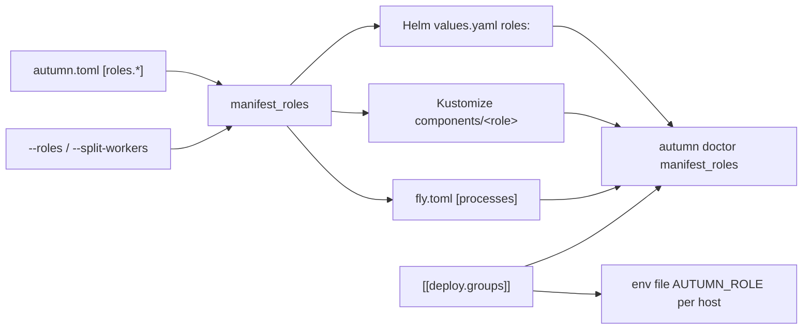

# ADR 0042: One Workload per Role in Release Manifests and Fleet Deploys

- Status: Accepted
- Date: 2026-11-08
- Deciders: Autumn maintainers
- Tags: roles, release, kubernetes, fly, deploy, doctor

## Context

Issue [#3547](https://github.com/autumn-foundation/autumn/issues/3547), part
of epic [#3540](https://github.com/autumn-foundation/autumn/issues/3540). It
builds on [ADR 0035](0035-named-roles.md) and
[ADR 0036](0036-route-groups.md).

`autumn release init --target kubernetes` wrote one Deployment with no
`AUTUMN_ROLE`. `autumn deploy` put every fleet host on the `combined` role.
An operator wrote a split topology by hand.

## Options

1. **Generic chart, generated values.** The Helm templates loop over a
   `roles:` map in `values.yaml`. The generator writes only the map.
2. **One generated file set per role.** The generator writes a Deployment,
   a Service and the rest for each role.
3. **A flag per built-in role.** `web.enabled`, `worker.enabled`. No named
   roles.

## Decision

Option 1 for Helm. Option 2 for Kustomize, because Kustomize has no loop.

- **The role set.** `--roles` wins. Else presets or `--split-workers` give
  `web`, `worker` and each preset. Else `combined` alone.
- **Helm.** Each role in `roles:` gets a Deployment (or a Rollout), a PDB
  and an optional HPA. Only a role with `servesHttp` gets a Service, an
  Ingress, a Rollout or a Flagger Canary. A worker keeps its probes: it binds
  the probe-only listener on the app port. Object names are
  `<fullname>-<role>`, at most 55 characters. The selector adds
  `app.kubernetes.io/component: <role>`.
- **Kustomize.** `base/` lists one component per role in
  `components/<role>/`. A component writes its labels literally: a component
  `labels` transformer would also label the other roles.
- **Fly.** One `[processes]` entry per role, `env AUTUMN_ROLE=<role>`. Fly
  balances `[http_service]` with no path routing, so only one HTTP group gets
  it: `web` or `combined`, else the first HTTP role. A `combined` app gets no
  change.
- **Fleet.** `[[deploy.groups]]` with `role` and `hosts`. Not together with
  `host` or `hosts`. A host is in one group. Each release dir gets
  `role.env`, and the slot unit reads it after the shared env file. A
  rollback then runs the old release with its own role. Preflight
  `deploy_group_roles` (on `up` and `check`, not on rollback) fails an
  undeclared role, and a split role on a jobs backend that hosts do not
  share.
- **Names.** Helm pods get `app: <name>-<role>`, because Flagger selects on
  `app`. A role name must end in a letter or a digit, and must not be a YAML
  boolean or null word.
- **Doctor.** `manifest_roles` warns when the Helm `roles:` keys,
  `AUTUMN_ROLE` in Kustomize, Fly or Compose, or `[[deploy.groups]] role`
  name a role that `autumn.toml` does not declare. It reads Helm values with
  a line scan, not a YAML parser, so the CLI gets no new dependency.
- **CI.** Golden copies of the Kubernetes output for a `web`, `worker` and
  `marketing` app and for a `combined` app. A Rust test keeps them equal to
  the generator. `scripts/check-k8s-manifests.sh` runs `helm lint`,
  `helm template`, `kustomize build` and `kubeconform` on them.
- `verification/role_manifests.rs` models the role set and the fleet groups.

## Consequences

- A regenerated chart names objects `<fullname>-<role>`. An upgrade replaces
  the Deployment and the Service. The Helm `replicaCount` moved under
  `roles`.
- The role is not in the shared env file. Option "env file" was simpler, but
  a rollback would then run the old release with the new role.
- `DeployConfig` has a new public field `groups`. A struct literal must set
  it.
- Option 2 for Helm would make the chart differ per app. Option 3 cannot
  name a preset.
