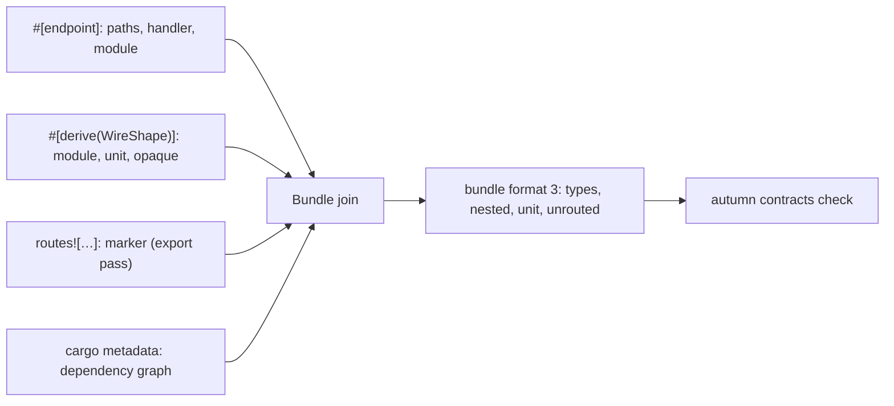

# ADR 0044: Type Identity, Nested Shapes and Served Routes in Wire Contracts

- Status: Accepted
- Date: 2026-11-10
- Deciders: Autumn maintainers
- Tags: wire-contracts, contracts, cli, macros

## Context

Issue [#3640](https://github.com/autumn-foundation/autumn/issues/3640), part
of epic [#3548](https://github.com/autumn-foundation/autumn/issues/3548).

`autumn contracts check` approved four kinds of break:

1. It found a type by its last name segment. `Json<shared::Item>` beside a
   local `Item` took the local one.
2. It compared a nested type by its name only.
3. A unit struct (`null`) and an empty struct (`{}`) had the same shape.
4. An `#[endpoint]` counted as served when no router registered it.

Also, a user type named `NoBody` read as the framework's empty body.

A proc macro sees tokens, not resolved types. It cannot call
`module_path!()`, and it cannot see `routes![…]` from `#[endpoint]`.

## Options

Type identity:

1. Path as written, the crate of the first segment, and nothing else.
2. Option 1, plus the source-file module of each type (`Span::local_file`,
   stable since Rust 1.88), plus the workspace dependency graph.
3. Emit a const and read it at run time. Rejected: descriptors are files
   that the macros write at expansion time.

Served routes:

1. `routes![…]` writes a marker. The export joins it with the endpoints.
2. The export builds each router through a test hook. Rejected: it needs a
   run, not a check.

## Decision

Type identity: option 2.

- `#[endpoint]` records the request and response paths as written, the
  handler name, and the module of its file.
- `#[derive(WireShape)]` records the module of its file. The descriptor file
  name holds the module.
- One resolver in `autumn-macros-support` picks the type. A crate in the
  first segment picks that crate. A bare name takes a type defined in the
  same module. Else the candidates are the own crate and the crates it can
  reach in the dependency graph. More than one candidate is an error that
  asks for the full path.
- The framework's `NoBody` is a candidate in `autumn-web` with no
  descriptor. A request with no `Json` parameter is the no-body case. The
  type name is not.

Nested types: the export resolves each type that a field names. It puts the
type in the bundle's `types` table, and puts its id in the field's
`nested` list. A type with no descriptor must be a known leaf (a
primitive, a standard container, `Uuid`, `DateTime` and similar), or the
field must have `#[wire(opaque)]`. Else the export stops.

Unit: `WireTypeDescriptor.unit`. The check compares it before the fields,
for bodies, list elements and nested types.

Served routes: option 1. The marker is written only in the export pass. A
crate is judged only when a marker in the pass names one of its endpoints.
A path that can name more than one handler registers each of them. A false
break blocks a deploy, so a missed break is the safer error here.

Format: the export always writes bundle format 3. An older CLI refuses it.
The check compares `unit` and nested types only when both bundles are
format 3.

## Consequences

- A field of an enum type, or of another type with no descriptor and no
  known-leaf name, stops the export until it has `#[wire(opaque)]`. This is
  a breaking change for the export, not for the build.
- A bundle from this CLI cannot be read by an older CLI.
- The module of a type is the module of its file. An inline `mod` is not
  visible. Two types with one name in one file share one descriptor file. A
  binary root gets its own module name (`main`, `bin::<name>`), so it does
  not share ids with the library.
- A `routes()` function that the app builds and never mounts still counts.
  A crate whose endpoints no marker names counts as served. So a router that
  drops every endpoint of a crate does not show.
- `autumn contracts export --from <dir>` joins a descriptor directory with no
  build. The golden tests use it.
