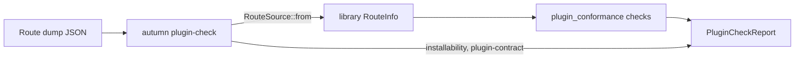

# ADR 0045: `autumn plugin-check` Uses the Library Conformance Rules

- Status: Accepted
- Date: 2026-11-10
- Deciders: Autumn maintainers
- Tags: plugins, conformance, cli

## Context

Issue [#2828](https://github.com/autumn-foundation/autumn/issues/2828).

`autumn plugin-check` (`autumn-cli/src/plugin_check.rs`) and
`autumn_web::plugin_conformance` had two copies of one rule set. Each copy
had its own report types and its own check functions. The copies drifted:

1. The CLI had no intentional-root exemption.
2. The CLI did not fail `--no-routes` together with `--prefix`.
3. The CLI gave other diagnostics for collisions and sensitive routes.
4. With `--no-routes`, the CLI counted routes under one name of the plugin.
   The library counts routes under every name.

Items 1 and 2 were fixed by hand. Item 3 and item 4 stayed.

The CLI reads routes from a JSON dump. There, the route source is a string.
The library `RouteInfo` uses the `RouteSource` enum. `RouteSource` already
reads `plugin:<name>` when it deserializes.

`plugin_conformance` is a stable plugin surface.

## Options

1. The CLI converts each dumped route to the library `RouteInfo`. Then it
   calls the library check functions.
2. The library checks become generic over a route trait.
3. Move the rules to a new crate.
4. Keep two copies. Add more name-scan tests.

## Decision

Option 1.

- `RouteSource` gets `From<&str>`. `Deserialize` uses it.
- The CLI uses the library `CheckStatus`, `CheckResult`, `SensitiveRoute`
  and `ConformanceReport`.
- `PluginCheckReport` wraps the library report with
  `#[serde(flatten)]`. It adds the data the plugin index reads: `contract`,
  `autumn_web`, `prefix` and `intentional_root`. The JSON shape does not
  change.
- The CLI calls `check_route_attribution`, `check_route_prefix`,
  `check_collisions`, `check_sensitive_surfaces`,
  `check_duplicate_registration`, `check_experimental_surface`, and the new
  `check_no_routes` and `check_prefix_with_no_routes`.
- The CLI keeps only what needs the built binary or the CLI flags:
  `installability`, `plugin-contract`, the contract-dump outcomes,
  `--deny-experimental`, the registered-name lookup, the split-name check,
  and the omitted-router check.
- `route_checks_match_the_library` runs both sides on the same routes. It
  fails when a route check gives a different result.

Option 2 adds a trait engine for one caller. Option 3 adds a crate for one
module. Option 4 does not stop drift.

## Consequences

- A rule change in `plugin_conformance` changes the CLI too.
- The public library API grows. It does not break.
- Some CLI output text changes. See the changelog.
- `--no-routes` still needs a contract with `registered_as` to skip. The
  library does not. `docs/plugins.md` gives this difference.
