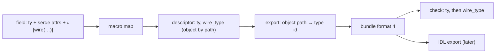

# ADR 0045: A Wire Type for Each Field in Wire Contracts

- Status: Accepted
- Date: 2026-11-10
- Deciders: Autumn maintainers
- Tags: wire-contracts, contracts, cli, macros

## Context

Issue [#3664](https://github.com/autumn-foundation/autumn/issues/3664), part
of epic [#3548](https://github.com/autumn-foundation/autumn/issues/3548).

`WireFieldDescriptor.ty` is the Rust type as written. It does not tell what
serde writes:

1. `#[serde(with = …)]` changes the JSON form, and `ty` stays the same.
2. `Option<T>` is found by name, so an alias for it reads as required.
3. An IDL export (`--proto`, `--avro`) must map each field to a JSON form.
   If the CLI parses `ty`, it repeats the guesses of the macro.

## Options

1. Parse `ty` in the CLI. Rejected: if the CLI parses `ty`, it repeats the
   rules of the macro, and it cannot see `#[serde(with)]`.
2. The macro writes a structured `wire_type` beside `ty`. A field attribute
   names it where the macro cannot read it.
3. Run serde at build time to get a sample. Rejected: a proc macro cannot
   run the type's code.

## Decision

Option 2.

- `WireType` lives in `autumn-macros-support`: `string`, `integer` (width,
  sign), `number`, `boolean`, `array`, `map`, `object`, `nullable`, `any`.
  A `string` or an `integer` can have a `format`, such as `date-time` or
  `unix-seconds`. The `kind` key tags each value.
- The field is `Option<WireType>`, so an older descriptor still parses.
- The macro maps a type by its last name, as the export finds a known leaf.
  A type it does not know is an `object` by the path as written. The export
  replaces the path with the type id, as for `nested`. A known leaf with no
  fixed form, and an unknown type in an opaque field, are `any`.
- `with`, `serialize_with` and `deserialize_with` make that direction `any`.
- A `time` crate type is `any`: its JSON form depends on a feature of that
  crate. The macro does not guess.
- `#[wire(type = …, format = …, nullable)]` sets the type for both
  directions, or for the one side that has a custom serde function. On an
  `Option<T>` field with no custom function, the type is made nullable. An
  unknown type is a compile error. `format` is free text: words of lowercase
  letters and digits, joined by `-`. So an app can name its own formats.
  The side that the override names is opaque: the export does not look for
  a shape of its Rust type. `nullable` on the deserialized side lets a
  request leave out the field.
- The check compares `ty` first. If `ty` reads and both sides have a wire
  type, the wire types must read: the same form, or a nullable form that
  wraps the other. Object ids do not count. The nested fields are compared
  on their own. `any` is not compared: it gives no data, as a missing wire
  type gives none. So a field whose two directions differ (one side
  `serialize_with`) does not break a release compared with itself.
- The export writes bundle format 4. The reader accepts formats 1 to 4.

## Consequences

- A new JSON form with the same Rust type is a break in both deploy windows.
- A field with `#[serde(with)]` and no override is `any`. A change to or
  from a custom form does not show until the field names its type.
- A bundle from this CLI cannot be read by an older CLI.
- A type of the app's own, named like a known type, gets the known type's
  wire type.
- The cross-release check still compares `ty`, so a type alias change with
  the same JSON form is still reported.
