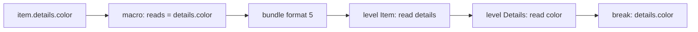

# ADR 0046: Dotted Paths in Wire-Contract Read-Sets and Write-Sets

- Status: Accepted
- Date: 2026-11-11
- Deciders: Autumn maintainers
- Tags: wire-contracts, contracts, cli, macros

## Context

Issue [#3691](https://github.com/autumn-foundation/autumn/issues/3691), part
of epic [#3548](https://github.com/autumn-foundation/autumn/issues/3548).

The cross-release check compares nested types field by field. But a caller's
read-set and write-set held top-level fields only. `item.details.color` read
`details`. So the check passed when the callee removed the optional
`Details.color`. In the callee-first window the deployed caller got `None`
with no error.

## Options

1. Record a dotted path (`details.color`) in the read-set and the write-set.
2. Record a tree (`{"details": {"color": {}}}`). Rejected: a new JSON shape
   for the same facts. It is harder to sort and to read in a diff.
3. Add a const assertion for each level through the nested `SHAPE`.
   Rejected as the only change: it does not help the cross-release check.
   In one build both ends share the nested type, so rustc already rejects a
   nested field that is gone.

## Decision

Option 1.

- The macros record a read as a dotted path. A field access, a binding of a
  field, a struct pattern, a value adapter (`.unwrap()`, `.as_ref()`) and a
  value callback (`.map(|d| d.color)`) extend the path. A `let`, an
  `if let` or a `match` inside a macro body binds its own names. Each parent
  path stays in the read-set: `details.color` also reads `details`. So an
  older CLI that exports these descriptors still finds the top-level read.
- A nested struct literal in a request records its fields as dotted paths.
  The parent stays in the write-set: `details` and `details.color`.
- The const assertions use the first segment of each path.
- The check splits the paths at each level. The first segments are the
  fields of the level. The rest goes to the nested type of that field. A
  field that the call site does not set with a struct literal has an unknown
  write-set.
- The result cache and the recursion guard use the type pair and the set as
  the key. A set gets shorter at each level, so a recursive type does not
  stop a deep read.
- The export writes bundle format 5. The reader accepts formats 1 to 5.

## Consequences

- The removal of an optional nested field that a caller or a consumer reads
  is a break in the callee-first window.
- A new optional nested field that a new caller reads needs the callee
  first.
- A nested field that a call site sets, and the callee drops, is a break.
- A field the type may skip (`skip_serializing_if`) counts as sent only when
  the caller's own release requires it. A call site that sets it is not
  enough: serde can still leave it out. This also holds at the top level.
- A bundle from this CLI cannot be read by an older CLI.
- A read through an index, a loop or another function stops at the field
  before it.
