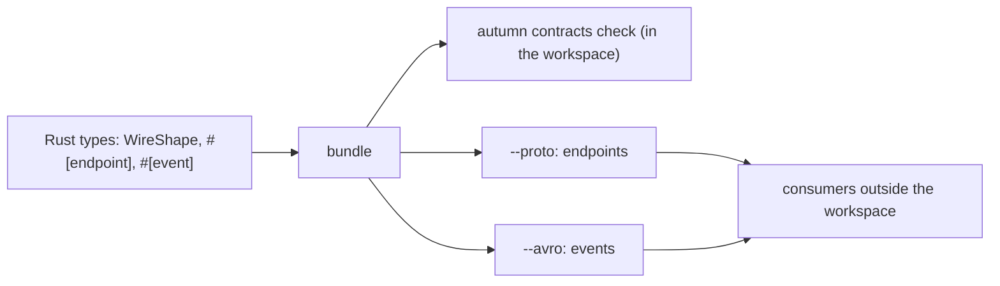

# ADR 0046: Rust Types Are the Wire Contract; an IDL Is an Export at the Edge

- Status: Accepted
- Date: 2026-11-11
- Deciders: Autumn maintainers
- Tags: wire-contracts, contracts, events, idl

## Context

Issue [#3667](https://github.com/autumn-foundation/autumn/issues/3667), part
of epic [#3548](https://github.com/autumn-foundation/autumn/issues/3548). It
records the decision behind
[#3665](https://github.com/autumn-foundation/autumn/issues/3665) and
[#3666](https://github.com/autumn-foundation/autumn/issues/3666).

Wire contracts come from Rust types. `#[derive(WireShape)]`, `#[endpoint]`
and `#[event]` record the shapes. `autumn contracts check` compares the
current release with the deployed release.

The epic does not include an IDL or a codegen step. Protobuf, Avro and
Thrift are made for service boundaries, so the question "why not use one?"
comes back. The answer depends on where the boundary is:

1. Inside one Cargo workspace. One build sees each caller, callee, producer
   and consumer.
2. At the edge of the workspace. The other side is in another repo, belongs
   to another team, or uses another language.

## Options

1. An IDL is the source of truth. Autumn generates Rust types from `.proto`
   or Avro files.
2. Rust types are the source of truth. A consumer outside the workspace reads
   the JSON bundle of `autumn contracts export`.
3. Rust types are the source of truth. At the edge, Autumn exports a
   standard IDL from the same contract.

Option 1 is rejected inside the workspace:

- An IDL checks one schema against another schema. Autumn checks against
  what each deployed caller and consumer reads and sends. In proto3, a
  callee can keep a response field in the schema and stop setting it. A
  deployed caller that reads the field then gets a default value, and
  nothing fails. In Autumn, the field is in the Rust type or it is not. If
  the callee removes it while a deployed caller reads it, the cross-release
  check reports a break.
- A `.proto` source of truth adds generated types next to the serde DTOs and
  the Diesel models. Someone must keep them in sync by hand. The wire macros
  exist to remove that drift.
- Most of the epic is about the shared database
  ([#3549](https://github.com/autumn-foundation/autumn/issues/3549),
  [#3550](https://github.com/autumn-foundation/autumn/issues/3550)). No wire
  format helps there.

Option 2 is rejected at the edge. A consumer outside the workspace needs a
standard schema and standard tools. The bundle is a format of Autumn only.

## Decision

Option 3.

- Inside one workspace, the contract comes from the Rust types:
  `WireShape`, `#[endpoint]`, `#[event]`, and `autumn contracts check`.
- Where a contract leaves the workspace, Autumn exports a standard IDL from
  the bundle:
  - `autumn contracts export --proto`: protobuf for endpoints (#3665).
  - `autumn contracts export --avro`: Avro for events and outbox messages
    (#3666).
- The Rust types stay the source of truth. An exported file is an output.
  Do not edit it.
- Autumn does not import IDL files. It does not generate Rust types from
  them.

Why these two formats:

- Protobuf is the common choice for request and response across languages.
  Its tools are mature: `buf`, and buffa or prost in Rust.
- Avro resolves a reader schema against a writer schema, and a schema
  registry has compatibility modes. These match the event rules that
  Autumn enforces now.
- The bundle has the data that an export needs: the wire type of each field
  ([ADR 0045](0045-wire-field-wire-types.md)) and the identity of each type
  ([ADR 0044](0044-wire-contract-type-identity.md)).

Thrift is not offered:

- It has its own RPC stack. The epic keeps HTTP and the outbox as the
  transport.
- A Thrift `required` field cannot be removed safely during a rolling
  deploy.
- Its Rust support is behind the other two.

## Consequences

- There is one source of truth. No generated types sit next to the serde
  DTOs and the Diesel models.
- Outside the workspace, the IDL's own tools check compatibility, for
  example `buf breaking` or a registry mode. They compare schemas only. They
  cannot see what an outside consumer reads.
- An export states only what the bundle holds. A gap in the bundle, such as
  query parameters, is also a gap in the export.
- A team that writes `.proto` or Avro files first cannot feed them to
  Autumn. It publishes the exported files instead.
- Until #3665 and #3666 ship, a consumer outside the workspace has only the
  JSON bundle.

## When to revisit

Reconsider an IDL as the source of truth at these boundaries if one of
these occurs:

- Extracted services move to separate repos, owned by separate teams, as
  the normal case.
- The "Limits of the first slice" list in the
  [wire-contracts guide](../guide/wire-contracts.md#limits-of-the-first-slice)
  keeps growing with items that an IDL already solves, such as nested types,
  wire representation or query parameters.
