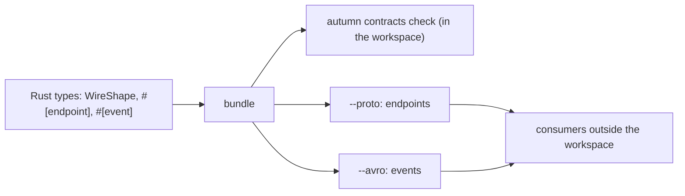

# ADR 0046: Rust Types Are the Wire Contract; an IDL Is an Export at the Edge

- Status: Accepted
- Date: 2026-11-11
- Deciders: Autumn maintainers
- Tags: wire-contracts, contracts, events, idl

## Context

Issue [#3667](https://github.com/autumn-foundation/autumn/issues/3667), part
of epic [#3548](https://github.com/autumn-foundation/autumn/issues/3548). It
records the decision behind
[#3665](https://github.com/autumn-foundation/autumn/issues/3665) (protobuf
export) and [#3666](https://github.com/autumn-foundation/autumn/issues/3666)
(Avro export).

Wire contracts come from Rust types. `#[derive(WireShape)]`, `#[endpoint]`
and `#[event]` record the shapes. `autumn contracts check` compares the
current release with the deployed release.

The epic does not include an IDL or a codegen step. Protobuf, Avro and
Thrift are made for service boundaries, so people ask why Autumn does not
use one. The answer depends on where the boundary is:

1. Inside one Cargo workspace. One build sees each caller, callee, producer
   and consumer.
2. At the workspace edge. The other side is in another repo, belongs to
   another team, or uses another language.

## Options

1. An IDL is the source of truth. Autumn generates Rust types from `.proto`
   or Avro files.
2. Rust types are the source of truth. A consumer outside the workspace reads
   the JSON bundle of `autumn contracts export`.
3. Rust types are the source of truth. At the workspace edge, Autumn exports
   a standard IDL from the same contract.

Option 1 is rejected inside the workspace:

- An IDL checks one schema against another schema. Autumn checks against
  what each `#[contract_checked]` caller and each bundled consumer reads and
  sends. In proto3, a callee can keep a response field in the schema and
  stop setting it. A deployed caller that reads the field then gets a
  default value, and nothing fails. If an Autumn callee removes a field that
  a deployed caller reads, `autumn contracts check` reports a break.
- A `.proto` source of truth adds generated types next to the serde DTOs and
  the Diesel models. Someone must keep these types in sync by hand. The wire
  macros exist so that no one does that.
- Most of the epic is about the shared database
  ([#3549](https://github.com/autumn-foundation/autumn/issues/3549),
  [#3550](https://github.com/autumn-foundation/autumn/issues/3550)). No wire
  format helps there.

Option 2 is rejected at the workspace edge. A consumer outside the workspace
needs a standard schema and standard tools. Only Autumn reads the bundle
format.

## Decision

Option 3.

- Inside one workspace, the contract comes from the Rust types:
  `WireShape`, `#[endpoint]`, `#[event]`, and `autumn contracts check`.
- At the workspace edge, Autumn exports a standard IDL from the bundle:
  - `autumn contracts export --proto`: protobuf for endpoints. It also
    writes a message for each event.
  - `autumn contracts export --avro`: Avro for events and outbox messages.
- The Rust types stay the source of truth. An exported file is an output.
  Do not edit it.
- Autumn does not import IDL files. It does not generate Rust types from
  them.

Why these two formats:

- Protobuf is the common choice for request and response across languages.
  Its tools are mature: `buf`, and buffa or prost in Rust.
- Avro resolves a reader schema against a writer schema, and a schema
  registry has compatibility modes. Both match the event compatibility rules
  that Autumn enforces.
- The bundle has most of the data that an export needs: the wire type of
  each field ([ADR 0045](0045-wire-field-wire-types.md)) and the identity of
  each type ([ADR 0044](0044-wire-contract-type-identity.md)).

Thrift is not offered:

- It has its own RPC stack. The epic keeps HTTP and the outbox as the
  transport.
- A Thrift `required` field cannot be removed safely during a rolling
  deploy.
- Its Rust support is behind the other two.

## Consequences

- There is one source of truth. No generated types sit next to the serde
  DTOs and the Diesel models.
- Outside the workspace, the IDL's own tools check compatibility, for
  example `buf breaking` or a registry mode. These tools compare schemas
  only. They cannot see what an outside consumer reads.
- An export states only what the bundle holds. A gap in the bundle is also a
  gap in the export: path parameter types, enum variants, query parameters,
  and fields with the wire type `any`.
- A team that writes `.proto` or Avro files first cannot give them to
  Autumn. The team publishes the exported files instead.
- Until the two exports ship, a consumer outside the workspace has only the
  JSON bundle.

## When to revisit

Reconsider an IDL as the source of truth at the workspace edge if one of
these occurs:

- Most extracted services move to separate repos with separate owners.
- The "Limits of the first slice" list in the
  [wire-contracts guide](../guide/wire-contracts.md#limits-of-the-first-slice)
  keeps growing with items that an IDL already solves, such as nested types,
  wire representation or query parameters.
