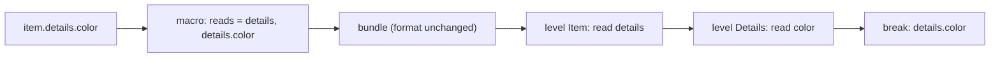

# ADR 0051: Dotted Paths in Wire-Contract Read-Sets and Write-Sets

- Status: Accepted
- Date: 2026-11-13
- Deciders: Autumn maintainers
- Tags: wire-contracts, contracts, cli, macros

## Context

Issue [#3691](https://github.com/autumn-foundation/autumn/issues/3691), part
of epic [#3548](https://github.com/autumn-foundation/autumn/issues/3548).

The cross-release check compares nested types field by field. But a caller's
read-set and write-set held top-level fields only. `item.details.color` read
`details`. So the check passed when the callee removed the optional
`Details.color`. In the callee-first window the deployed caller got `None`
with no error.

## Options

1. Record a dotted path (`details.color`) in the read-set and the write-set.
2. Record a tree (`{"details": {"color": {}}}`). Rejected: a new JSON shape
   for the same facts. It is harder to sort and to read in a diff.
3. Add a const assertion for each level through the nested `SHAPE`.
   Rejected as the only change: it does not help the cross-release check.
   In one build both ends share the nested type, so rustc already rejects a
   nested field that is gone.

## Decision

Option 1.

- The macros record a read as a dotted path. A field access, a binding of a
  field, a struct pattern, a value adapter (`.unwrap()`, `.as_ref()`) and a
  value callback (`.map(|d| d.color)`) extend the path. A `let`, an
  `if let` or a `match` inside a macro body binds its own names. Inside a
  macro body only an `x`, `Some(x)` or `Ok(x)` binding holds the value: a
  struct pattern or a closure parameter stops the path at its parent, so
  `html! { (item.details.as_ref().map(|d| d.color)) }` reads `details` only.
- Each parent path stays in the set: `details.color` also reads `details`.
  A nested struct literal in a request records its fields as dotted paths,
  and the parent stays in the write-set: `details` and `details.color`.
- The const assertions use the first segment of each path.
- The check splits the paths at each level. The first segments are the
  fields of the level. The rest goes to the nested type of that field. A
  field that the call site does not set with a struct literal has an unknown
  write-set.
- The result cache and the recursion guard use the type pair and the set as
  the key. A set gets shorter at each level, so a recursive type does not
  stop a deep read.
- The bundle format does not change. Because each set keeps its prefixes,
  an older CLI and an older bundle still see the top-level fields and keep
  the old behavior.

## Consequences

- The removal of an optional nested field that a caller or a consumer reads
  is a break in the callee-first window.
- A new optional nested field that a new caller reads needs the callee
  first.
- A nested field that a call site sets, and the callee drops, is a break.
- An older CLI reads a bundle from this CLI. It compares the top-level
  fields only, as before.
- Another method call (`.first()`, `.iter().map(..)`) or a read through
  another function stops the path at the field before it.
- A loop or an index over a nested list keeps the path:
  `item.lines[0].price` reads `lines.price`. A loop or an index over the
  whole response reads none of its fields.
- A typed maud binding, a `match` in a macro body and a maud `@match` keep
  the path (#3737, issue #3717). In a macro body, only an `x`, `Some(x)` or
  `Ok(x)` binding holds the value, also with `&`, `ref` or `mut`.

## History

This decision was first written as ADR 0046 with the change in #3705. That
pull request was merged into `trunk` instead of `trunk-dev`, so neither the
record nor its compile-pass test reached the development line. The change
itself landed on `trunk-dev` in #3716. This ADR restores the record under a
free number and states what shipped: the first draft planned a new bundle
format, which #3716 did not need.
