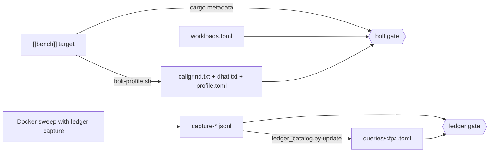

# Performance profiles: Bolt and Ledger

Two kinds of profile cover the framework. CI gates both: a new workload or a
new query fails the build until it has a profile.

| | Bolt | Ledger |
|:--|:--|:--|
| Unit | a workload: one `[[bench]]` target | a query: one normalized SQL statement |
| Measures | instructions (callgrind) and allocations (dhat) | plan shape and index use (`EXPLAIN`), call sites |
| Catalog | `docs/perf/bolt/<package>/<bench>/` | `docs/perf/ledger/queries/<fingerprint>.toml` |
| Manifest | `docs/perf/bolt/workloads.toml` | the capture of the Docker sweep |
| Write it | `scripts/bolt-profile.sh <package>/<bench>` | `scripts/ledger-profile.sh` |
| Gate | `scripts/check-perf-profiles.py bolt` (CI `lint`) | `scripts/check-perf-profiles.py ledger <capture>` (CI `Test (Docker)`) |

The other directories here are deep, hand-written investigations of one hot
path each. They seed a production-shaped fixture and read
`pg_stat_statements` before and after a change. The catalog does not replace
them. It makes sure no workload and no query is left with no profile at all,
and it points at the queries that deserve a deep one.

## Bolt: every workload

A workload is a bench target. `cargo metadata` lists them, so a bench that
Cargo discovers without a `[[bench]]` entry counts too.

### Add a workload

1. Write the bench. Like the others in `autumn/benches/`, give it a
   `--iterations N` argument (or similar) so a profiler can subtract
   start-up.
2. Add a `[[workload]]` entry to `docs/perf/bolt/workloads.toml`. Use
   `mode = "marginal"` when the bench takes an iteration count. Use
   `"whole"` for a fixed workload and `"criterion"` for a criterion bench.
3. Run `scripts/bolt-profile.sh <package>/<bench>` and commit the directory
   it writes.

An entry may carry `exempt = "<reason>"` instead of a profile.
`request_pipeline` is the one exempt workload: AGENTS.md records that it is
exhausted (#2830).

### What a profile holds

* `profile.toml`: the build and valgrind commands, toolchain, commit, the
  SHA-256 of the bench source, and the totals.
* `callgrind.txt`: the top functions by self instructions.
* `dhat.txt`: total bytes and blocks allocated, and the top allocation
  sites, each named by its first workspace frame.
* `ledger.txt`, for a Postgres workload (`ledger = "postgres"`): the
  statements, rows and shared buffers per iteration, from
  `pg_stat_statements`. The runner resets it before a native run of the
  bench, so valgrind does not slow the database side. Set `BOLT_PG_URL` to a
  server that preloads `pg_stat_statements`.

In marginal mode, every figure is per iteration: the N-iteration run minus
the zero-iteration run, divided by N. That is the convention the bench
headers in `autumn/benches/` describe.

The gate fails when a profile is missing or empty. It warns, and does not
fail, when the bench source changed since the profile was taken: re-run the
profile when the change is meant to move it.

Callgrind counts instructions, so a profile is reproducible on any x86-64
Linux host with the same toolchain. Wall-clock time is not recorded.

## Ledger: every query

### The capture

The `ledger-capture` feature compiles `autumn/src/ledger_capture.rs`. With
`AUTUMN_LEDGER_CAPTURE_DIR` set, it installs a diesel default
instrumentation before `main`. For each statement it records:

* **The fingerprint**: the SHA-256 of the normalized text. Literals become
  `?` and parameters `$?`. A run of parameters, and a run of equal tuples,
  collapses, so a 3-row and a 30-row batch insert are one query.
* **The call site**: the innermost stack frame in a workspace `src/` file.
  A statement whose innermost workspace frame is test code is a fixture and
  is not recorded.
* **Two generic plans**: on a side connection to the same database,
  `EXPLAIN (GENERIC_PLAN, COSTS OFF)` as planned and with
  `enable_seqscan = off`. The statement never runs twice. A plan waits at
  most 100 ms for a lock, so it cannot stall the test it observes.
  `GENERIC_PLAN` needs Postgres 16, and most testcontainers run the module
  default, `postgres:11-alpine`. For those, the capture copies the test
  database's schema with `pg_dump --schema-only` into a database on the
  Postgres 16 server that `AUTUMN_LEDGER_PLAN_URL` names, and plans there.
  The profile's `planned_on` says which.
* **Calls**: how often each site ran each statement.

Transaction control and `SET` are not queries. DDL is captured but not
gated: the migration gates cover it.

CI's "Run Docker-dependent tests" step builds the `integration_tests` sweep
with `ledger-capture`. The step after it runs the gate on the capture and
uploads it as the `ledger-capture` artifact.

### What a profile holds

`docs/perf/ledger/queries/<fingerprint>.toml`:

* `statement`, `kind` (`read`, `write`, `batch`, `utility`, `other`) and
  `backend`.
* `tables` and `indexes` the plans touch.
* `findings`:
  * `full-scan: <table>` when a sequential scan survives
    `enable_seqscan = off`. No index can serve that scan.
  * `sort` when the order needs a sort node, even with index scans
    preferred.
* `[[site]]`: each production function that issues the statement.
* `[plan]`: both plans, or why there is none.
* `notes`: free text for a person. A refresh keeps it.

The plans come from the test databases, so their statistics are those of a
test fixture. Read the index-forced plan for what an index can serve. Read a
deep Ledger investigation for what a production-sized table costs.

The catalog stores no call counts: they change with every new test and would
make every pull request rewrite the same files. Run
`scripts/perf/ledger_catalog.py report <capture>` for them.

### Add a query

Run `scripts/ledger-profile.sh`. It runs the sweep with the capture on,
writes a profile for each statement that has none, and runs the gate.
Commit the new files under `docs/perf/ledger/queries/`. On a machine
without Docker, download the `ledger-capture` artifact of the failed CI run
and run `scripts/perf/ledger_catalog.py update <dir>` on it.

To capture part of the sweep, pass libtest filters:
`scripts/ledger-profile.sh -- job::`.

### Limits

* The capture sees what the sweep runs. A query that no Docker test reaches
  is not gated. Write the test.
* A query built by a `#[repository]` macro expands into the crate that
  invokes the macro. When that crate is a test file, the capture treats the
  statement as a fixture. The `repository_crud` Bolt workload covers the
  generated code path.
* A profile that the capture did not see is reported as stale, not failed.
  Delete it when its query is gone.
